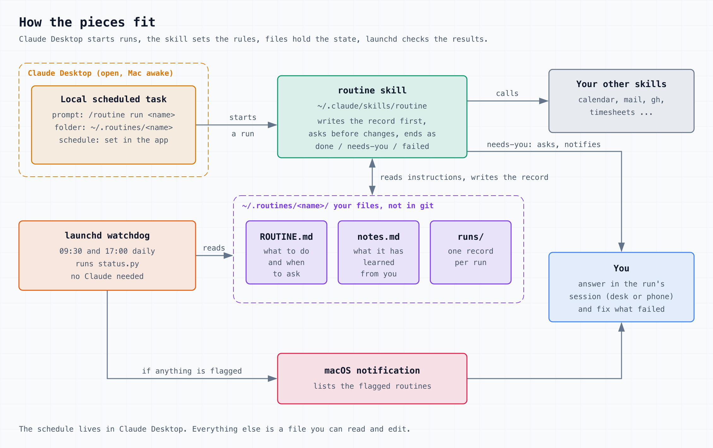
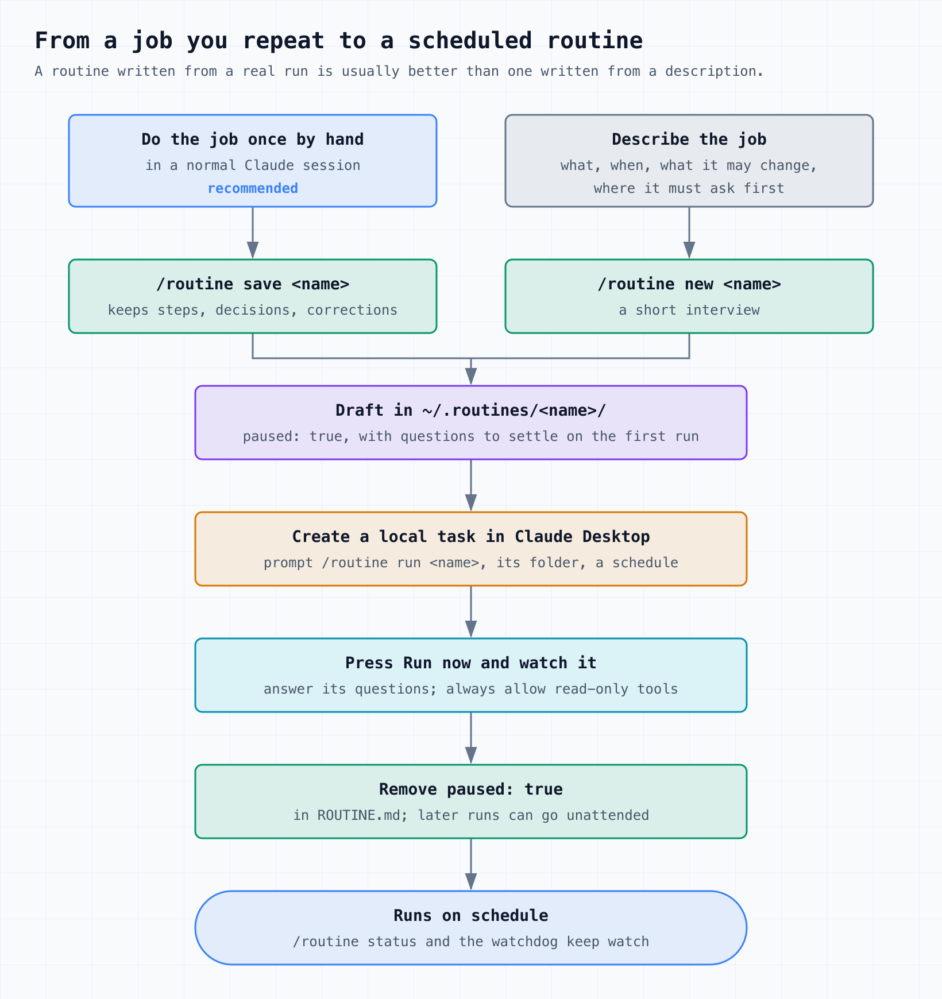
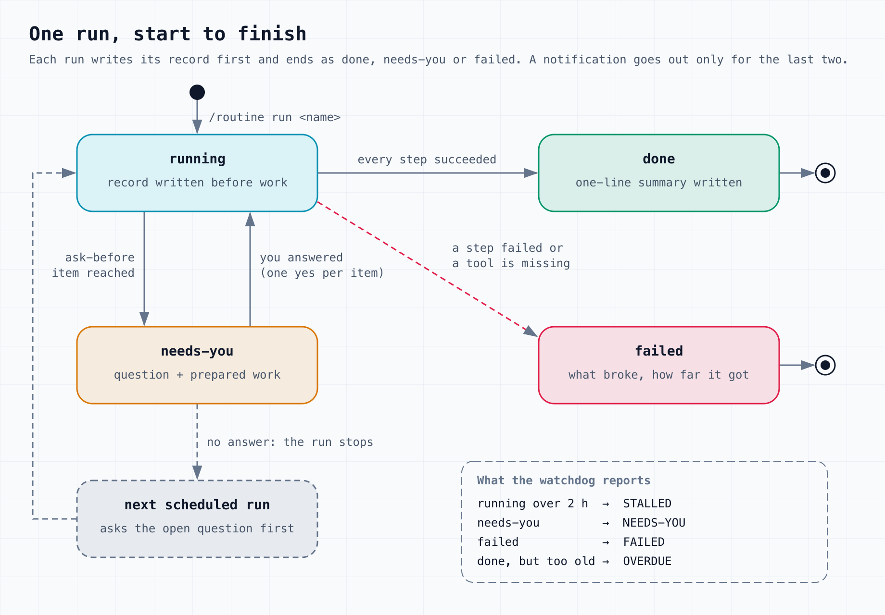
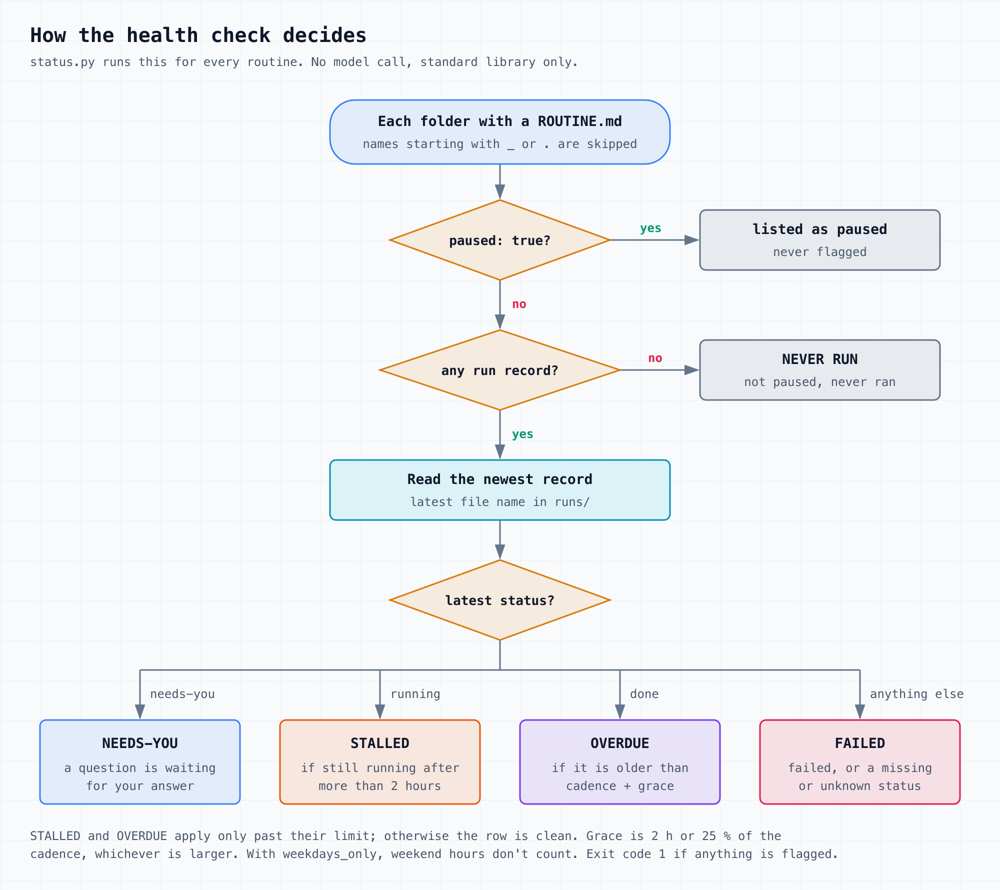

# User guide: the routine skill

This guide is for people who use Claude Code and Claude Desktop on a Mac. It shows how to let Claude do a job that repeats, such as a Friday timesheet check or a morning briefing. You need no programming. A routine is a markdown file that you can read and edit.

## What a routine is

A skill teaches Claude how to do something, for example how to read your calendar or how to book time. A routine says when to do it, on whose data, and where Claude must stop and ask you first. Routines call skills. They do not copy them.

Each routine is a folder of plain files. Claude Desktop starts it on a schedule, the `routine` skill makes every run follow the same rules, and a small script checks that no run failed quietly.



Four rules hold for every routine:

- **Claude asks before it acts in your name.** It stops before it sends, books, approves, merges or deletes, and it waits for your yes. One yes covers one item.
- **No run fails silently.** Each run writes a record before it starts work and ends as `done`, `needs-you` or `failed`. A check outside Claude flags anything else.
- **Claude remembers across runs.** Your preferences and corrections go into a notes file, not into a conversation that disappears.
- **Everything is a file.** You can open every routine, note and run record in an editor.

## Install

```
npx skills add kevinlin/claude-routines -g -a claude-code
```

This puts the skill at `~/.claude/skills/routine`. You also need:

- Claude Desktop on macOS. Its local scheduled tasks start your routines.
- `python3` for the health check. macOS includes it with the command line tools.

To check the install, type `/routine status` in a Claude Code session. Before you create a routine, it shows an empty table.

## Your first routine



There are two ways to start.

**Do the job once by hand, then save it.** This is the better way. Do the job in a normal Claude Code session, with the skills and tools it needs. Correct Claude where it gets something wrong. Then type:

```
/routine save standup-prep
```

Claude writes the routine from what happened in the session:

- The steps that you actually needed, in order. Dead ends are left out.
- Each point where you made a decision becomes an "Ask before" item.
- Each correction you gave goes into `notes.md`.

Claude shows you the draft and asks what is wrong or missing before it saves anything.

**Describe the job.** Type `/routine new standup-prep`. Claude asks a few short questions: what the job is for, when it runs, what it reads, what it may change, where you want to be asked, and how you will know it went well. Then it writes the folder.

Both ways give you a draft in `~/.routines/standup-prep/` with `paused: true`. A new routine can also end with a "Settle on the first run" section: questions that Claude asks you on the first supervised run. Your answers go to `notes.md`, and the section is then deleted.

## Inside a routine folder

```
~/.routines/
  standup-prep/
    ROUTINE.md                what to do; you edit this to change the routine
    notes.md                  what Claude has learned about your preferences
    runs/2026-11-20-0900.md   one record per run
```

Set `ROUTINES_HOME` if you want the routines somewhere other than `~/.routines`. A folder counts as a routine when it holds a `ROUTINE.md` and its name does not start with `_` or `.`.

### ROUTINE.md

Here is a complete example:

```markdown
---
name: standup-prep
purpose: Tell me what I did yesterday and what is on today, before standup.
schedule: Weekdays 09:00
cadence_hours: 24
weekdays_only: true
paused: true
runs_on: desktop-local
---

## Goal

A short note for today exists at `prep/<YYYY-MM-DD>.md`.

## Steps

1. Yesterday's merged pull requests and commits in the repos listed in `notes.md`, with `gh`.
2. Today's meetings from my calendar.
3. Write the note: done yesterday, planned today, blockers. 10 lines at most.

## Ask before

- Posting the note anywhere. This routine only writes inside its own folder.

## Done when

- The note for today exists and every source was read.

## Report

- Summary line: number of pull requests and meetings.
- Notify on success: no
```

The frontmatter is a list of flat `key: value` lines. The health check reads nothing else, so do not nest values.

| Field | What it means |
|---|---|
| `name` | The folder name. |
| `purpose` | One sentence, in your words. |
| `schedule` | When it runs, written for people. This is a note only. The real schedule is in Claude Desktop. |
| `cadence_hours` | The longest normal gap between runs: 24 for daily, 168 for weekly, 744 for monthly. |
| `weekdays_only` | `true` if the routine never runs at weekends, so it is not flagged overdue on Monday morning. |
| `paused` | `true` while the routine is a draft or switched off. The health check then ignores it. |
| `runs_on` | `desktop-local`, or `cloud` for a cloud scheduled task. |

Write the Steps as results to get and the skill to use. Do not write shell commands. The skill knows the commands and stays current when they change.

### notes.md

This file holds your standing preferences and corrections, for example "don't book time on project X" or "keep it under ten lines". Claude reads it at the start of every run and adds to it when you tell it something that should hold next time. Each note is short and has a date. When a new note contradicts an old one, the old one is removed. You can edit the file yourself at any time.

### Run records

Each run writes one file in `runs/`. Its name is the start time:

```markdown
---
status: done
started: 2026-11-20T09:00:12
ended: 2026-11-20T09:01:40
summary: 3 pull requests merged, 4 meetings today.
---

## Done
- Read 2 repos and the calendar. Wrote prep/2026-11-20.md (8 lines).
```

A `needs-you` record also has an `## Open question` section with the question, the options and the work already prepared. A `failed` record has an `## Error` section with the message and how far the run got.

## What happens in a run



When the scheduled task fires, or when you type `/routine run standup-prep`, Claude does the same eight things each time:

1. It reads `ROUTINE.md`, `notes.md` and the newest run record.
2. It writes the new run record with `status: running` before it does any work. If the run then crashes, the record shows it.
3. If the last run is still waiting on a question, it asks that question first, with the work already prepared. It does not do the work again and it does not choose an answer for you.
4. It does the Steps with the skills they name, and applies everything in `notes.md`.
5. It stops at each "Ask before" item (see the next section).
6. It closes the record as `done` with a one-line summary, or as `failed` with the reason. If any step failed or was skipped, the run is not `done`.
7. It adds new preferences and corrections to `notes.md`.
8. It sends a notification only for `needs-you` or `failed`, or when the Report section asks for one on success.

Claude does not notify you about clean runs. If it did, you would soon learn to ignore its notifications.

## When Claude asks first

Claude asks before each "Ask before" item. It also asks before any change outside the routine's own folder that the routine does not explicitly allow, such as sending, booking, approving, merging or deleting. Before it asks:

- It finishes the read-only work first, so that one answer settles the question.
- It sets the record to `needs-you`, writes the question into the record, asks in the session and sends a notification.

You answer in that run's session in Claude Desktop. With Remote Control on, you can also answer from your phone. The run then continues. A yes to Monday's booking is not a yes to Tuesday's.

If you do not answer, the run stops and the record stays `needs-you`. The next run asks the same question before it does anything else, so nothing is lost.

If a skill has its own confirmation step, for example a preview before it books, Claude follows that too. That step does not replace the routine's own question.

## Schedule it in Claude Desktop

1. In Claude Desktop, go to Scheduled > New > Local.
2. Name the task after the routine. Set the prompt to `/routine run standup-prep`, the folder to `~/.routines/standup-prep`, and the schedule to match the routine's `schedule` line.
3. Press **Run now** and watch the first run. Answer its first-run questions. When it asks for permission to use a read-only tool, choose "always allow". Leave every tool that writes on "ask".
4. When the run looks right, remove `paused: true` from `ROUTINE.md`.

Never set a routine to bypass permissions to make it run unattended. The stops are how you stay in charge of what is done in your name.

## Check that it worked

Type `/routine status` in any Claude Code session, or run the script directly:

```
python3 ~/.claude/skills/routine/scripts/status.py
```

It prints one row per routine: its status, its last run, a flag and the summary line.



| Flag | What to do |
|---|---|
| `NEEDS-YOU` | Open the run in Claude Desktop and answer. Or run the routine again, and it asks first. |
| `STALLED` | The run crashed or hung. Read the record, then run the routine again. |
| `FAILED` | Read the `## Error` section of the record, fix the cause (often a login or a missing tool), and run again. |
| `OVERDUE` | The routine did not run when expected. Is Claude Desktop open? Is the scheduled task on? |
| `NEVER RUN` | You removed `paused: true`, but the routine has no run yet. Press Run now. |

### The watchdog

The watchdog runs the same check at 09:30 and 17:00 every day, even when Claude is closed. It posts one macOS notification that lists the flagged routines. Install it once:

```
cp ~/.claude/skills/routine/launchd/dev.routines.status.plist ~/Library/LaunchAgents/
launchctl bootstrap gui/$(id -u) ~/Library/LaunchAgents/dev.routines.status.plist
```

To remove it:

```
launchctl bootout gui/$(id -u)/dev.routines.status
rm ~/Library/LaunchAgents/dev.routines.status.plist
```

The output goes to `~/Library/Logs/routines-status.log`. The watchdog expects the skill at `~/.claude/skills/routine`.

## Everyday changes

| I want to | Do this |
|---|---|
| Change what a routine does | Edit its `ROUTINE.md`. The next run uses it. |
| Correct how it does something | Tell Claude during a run, or add a line to `notes.md`. |
| Change when it runs | Edit the task in Claude Desktop. Update the `schedule` line to match. |
| Run it now | `/routine run <name>` in any session, or Run now in Claude Desktop. |
| Pass something to one run | `/routine run <name> <args>`, if the routine says what it accepts. |
| Switch it off | Set `paused: true` and pause the Desktop task. |

## Limits

- Routines run only while Claude Desktop is open and the Mac is awake. After sleep, Desktop starts one catch-up run for the most recent missed time. A 09:00 routine can then start at 23:00. Claude checks the time and records that the run was a catch-up.
- Nothing checks that the `schedule` line matches the task in Claude Desktop.
- A tool that asks for permission every time stops an unattended run until you answer.
- If a tool or login is not available, the run is `failed` with the exact message. Claude does not use a different source and report as if nothing changed.
- If a run dies before it writes its record, it is not visible until it shows as `OVERDUE`.
- Some Claude Desktop behaviour has not been tested yet: answering from the phone, and what the next scheduled fire does while a run waits. The README's "First: the Desktop spike" section lists four checks to do once with a throwaway task.
